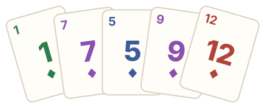

# Handsum

<!-- markdownlint-disable-next-line MD033 -->


A browser-based multiplayer card game prototype for 2 to 8 players. Players join a round via a shared link; the browser clients exchange moves through a small PHP server that only stores the move log.

> **Unofficial fan project, not affiliated with the original publisher.** See the [disclaimer](#-disclaimer).

## ✨ Features

- Complete rules for 2 to 8 players, played online via a room link, no accounts
- Game logic runs entirely in the browser (Vue 3, TypeScript, Vite); every client validates every move
- Animated card table with a lobby, rematches and reconnecting after a reload
- English and German interface, chosen from the browser language and switchable in the footer
- Interactive tutorial against a scripted opponent, fully offline in the browser
- Tiny PHP server for shared hosting: an ordered move log per room in plain files, no database
- No tracking, no external fonts or CDNs; the server never sees room codes or IP addresses in clear text
- Automated lint, tests, build and deployment via GitHub Actions

## 📝 Getting Started

### 📦 Prerequisites

- [Node.js](https://nodejs.org/) and [npm](https://www.npmjs.com/). The required Node.js version is pinned in `mise.toml` (use [mise](https://mise.jdx.dev/) and run `mise install`).
- [Docker](https://www.docker.com/) or [Podman](https://podman.io/) with Compose for the PHP tools. With Podman enable the API socket once: `systemctl --user enable --now podman.socket`.

### 🛠️ Installation

```bash
npm install
npm --prefix client install
```

### 🖥️ Start development server

```bash
npm run server:dev   # PHP API on port 8080, in its own terminal
npm run client:dev   # Vite dev server
```

To try it alone, open the room link in two browser windows.

### 🏗️ Build

```bash
npm run client:build
```

The site, including the server as `api/`, is built to `client/dist/`.

### 🧪 Test

```bash
npm test   # client and server tests
```

### ✅ Lint

```bash
npm run lint   # client, other files and server
npm run fix    # autofix where possible
```

## 📚 Docs

- [`docs/structure.md`](docs/structure.md) – repository layout, how the game works, all npm scripts
- [`docs/deployment.md`](docs/deployment.md) – deployment to shared hosting, first deployment, password protection
- [`docs/privacy.md`](docs/privacy.md) – what the server stores and for how long

## 📄 License

The code is licensed under the [MIT License](LICENSE).

## 📜 Disclaimer

Handsum is an unofficial, non-commercial fan project based on the game mechanics of the card game Cabo by Mandy Henning and Melissa Limes, published by Smiling Monster Games. It is not affiliated with or endorsed by the authors or the publisher. Only the mechanics are adopted; all names, rule texts, card designs and artwork in this project are original. If you are a rights holder and have concerns, please open an issue.
